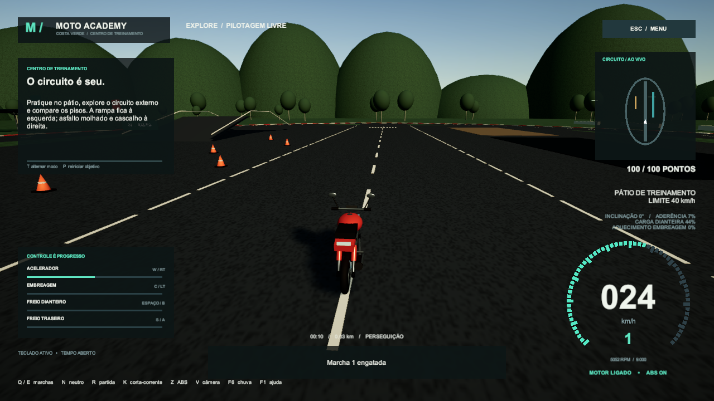

# Moto Academy — Costa Verde

Simulador de motocicleta manual em Unity, com aulas, pilotagem livre e avaliação em um centro de treinamento 3D.

- Cinco marchas, embreagem progressiva, freios independentes e ABS alternável.
- Dez aulas, circuito de avaliação, diferentes pisos e chuva.
- Três câmeras, painel de instrumentos e progresso salvo.

**Windows:** baixe o pacote na seção Releases, extraia a pasta inteira e abra `MotoAcademy.exe`.

**Projeto Unity:** veja [instruções e controles](MotoAcademyUnity/README.md). Desenvolvido e compilado com Unity **6000.3.0f1**.

